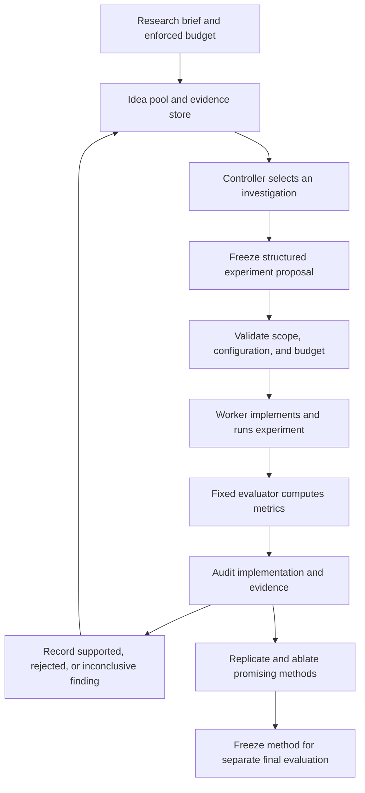

# Autonomous research plan for NonSmoothOperator

Status: baseline identification and a bounded sequential research loop are
implemented. Numerical selector comparisons are development evidence; the
broader research automation and confirmation study remain proposed.
Last updated: 7 October 2026.
Immediate task: define a bounded test of expected prediction-error reduction
as a selection objective. The [contact-entropy ablation](../experiments/contact-entropy-ablation.md)
found no reliable benefit from the bonus: removing it changed two of 24 sequences,
helping one case and hurting another. Numerical refinement passes the recorded
cases, but neither score beats local Fisher D in pooled results. The initial Gate 0
decision is **narrow**; broader literature tracing and confirmation freeze remain
outstanding before a novelty claim or campaign expansion.

## Objective

Build an automated research loop that proposes hypotheses about hybrid-system
identification, implements experiments, runs simulations and model fitting,
checks the evidence, and selects the next investigation within a fixed budget.
The output should be reproducible findings and evaluated methods, with explicit
limits on what the evidence supports.

Scientific success must be independent of an LLM or PINN victory. Deliver a
reliable benchmark with hidden impact times, an explanation of when measurement
constraints cause selection failures, and a fair comparison of numerical and
LLM selectors in accuracy, experiment count, and computational cost. A negative
result is useful when its scope, mechanism, and reproducibility are clear.

The first research question is:

> When do sparse, noisy position measurements make contact parameters difficult
> to identify, and which experiment-selection methods resolve that ambiguity?

Begin with unknown floor height and restitution in the bouncing-ball system.
Distinguish insufficient information in the observations from optimization
failure in the estimator. Later, test whether findings transfer to a system with
friction, multiple impacts, or imperfectly known dynamics.

This document proposes infrastructure for doing the research. It does not claim
that the infrastructure, the current ball model, or combining an LLM with a PINN
is itself novel. A contribution needs comparison with relevant prior work and
evidence beyond the initial example.

## One candidate claim

**H1, proposed and unconfirmed:** When sparse position measurements leave
multiple contact outcomes plausible, selecting an input using a distribution
over those hypotheses improves subsequent identification relative to a local
Fisher-information selector based on one fitted model, at the same observation
and experiment budget.

The initial contrast is contact versus no contact within a fixed horizon. This
is the smallest event-sequence distinction; multiple impacts and friction are
later extensions. Both selectors must account for the actual sensor schedule
and noise. Beating a selector that ignores those quantities does not support H1.

The candidate mechanism is the loss of alternative explanations when a
distribution is reduced to one fitted parameter vector. Large local sensitivity
need not resolve ambiguity between explanations with different contact events.
This is an inference to investigate, not an established defect in a particular
published algorithm. Expected information gain and Bayesian model discrimination
are existing methods; using them does not establish algorithmic novelty.

The default practical target is a 20% reduction in mean normalized position
prediction RMSE after five additional experiments. These are proposed protocol
choices, not measured results. Gate 0 may revise them before protocol freeze.
Specify the normalization, observation count per experiment, primary comparator,
and confirmation sample size before collecting confirmation outcomes.

### Gate 0: Establish the gap before scaling implementation

Read the final published contact-aware paper, its supplement and available code;
check differences from the preprint. Follow the closest relevant references and
citing work. Produce a concise comparison table with section/equation references:

| Prior work | Established overlap | Question to resolve before claiming a gap |
| --- | --- | --- |
| Sathyanarayan and Abraham, [Behavior Synthesis via Contact-Aware Fisher Information Maximization, RSS 2025](https://www.roboticsproceedings.org/rss21/p118.html); [preprint](https://arxiv.org/html/2505.12214v1) | Contact-dependent sensor information and actively chosen contact behavior already exist. The preprint discusses limitations of dynamics uncertainty in Section VII. | What uncertainty is retained during selection? Can its measurement model and optimizer represent competing contact outcomes? Which parts transfer faithfully to a ball observed through positions? |
| Odunlami et al., [Salted Fisher Information for Hybrid Systems, 2026 preprint](https://arxiv.org/html/2603.29862v1) | Sensitivity updates at jumps and hybrid Fisher information already exist; Assumption 3.1 requires transversal crossings and finitely many transitions. | How should the comparison handle uncertainty across different event sequences, singular information, and failure of the regularity assumptions? |
| Kim et al., [Tactile Probabilistic Contact Dynamics Estimation of Unknown Objects, 2024](https://arxiv.org/abs/2409.17470) | Joint geometry/physical-parameter estimation with particles and active information gathering already exists. | Does this already implement the proposed mechanism? What specific observation regime, approximation, or failure analysis could our work add? |

The [comparison note and development protocol](contact-design-comparison.md)
record the targeted final-paper, appendix, preprint, and released-code inspection.
The initial decision is **narrow**: Bayesian contact selection already exists;
investigate sparse dynamic measurements and approximation/cost tradeoffs. Full
replication and broader reference tracing remain outstanding. Do not describe
absence from an abstract or one limitations section as proof of a literature gap.

**Required deliverable:** a local comparison note containing (1) the exact
overlap, (2) a faithful baseline or a clearly labelled adaptation, (3) the smallest
experiment that discriminates H1 from its alternatives, and (4) one of these
decisions:

- **Proceed:** an explicit, testable gap remains; freeze H1 and its protocol.
- **Narrow:** existing methods cover the mechanism; investigate a specific
  failure regime, approximation/cost tradeoff, or benchmark contribution.
- **Reject the novelty claim:** the proposed result is already covered. Preserve
  the reproduction and formulate a different question before more experiments.

Do not weaken a baseline to make H1 succeed. If an adaptation changes the sensor
model, contact law, or optimization objective, enumerate those changes and
describe the result as a comparison with the adaptation, not a refutation of
the original paper.

## Background on research automation

These sources motivate execution practices. They are not the related-work
evidence for H1, and their architectural suggestions do not take priority over
Gate 0 or the numerical checks below. Source descriptions retained from the
existing draft require verification before reuse in a paper or report.

The following are reported methods, not independent reproductions of their
results. The architecture below is our adaptation.

| Source | Disclosed method | Practice to adopt |
| --- | --- | --- |
| OpenAI, [Research acceleration: The view inside OpenAI](https://openai.com/index/research-acceleration-view-inside-openai/), 6 September 2026 | Coding agents undertake implementation, execution, analysis, and troubleshooting, often concurrently. People still set priorities and judge results. The report describes substantial human steering on longer tasks. | Delegate bounded research tasks and retain explicit milestones and evidence checks. |
| OpenAI, [Navier–Stokes research account](https://openai.com/index/navier-stokes-solution/), 8 September 2026 | Groups explored different formulations and approaches. An intermediate Euler result redirected the effort; Codex consolidated insights for later attempts. The successful group reportedly involved approximately 10,000 concurrent agents, followed by Lean formalization and verification. | Explore distinct hypotheses, share checked intermediate findings, and reallocate effort using evidence. The internal model and complete orchestration are not provided by this announcement. |
| OpenAI, [mathematics release](https://openai.com/index/sharing-ai-progress-in-mathematics/), 6 October 2026, and [repository methodology](https://github.com/openai/math#how-the-results-were-produced) | Approximately 4,000 problems were posed to an internal model, with around three hours of thinking compute per result on average. Selected reasoning summaries and available formalizations were released. | Record attempts and verification status. Do not assume the whole collection used the Navier–Stokes multi-agent procedure. |
| OpenAI and Ginkgo, [automated laboratory study](https://openai.com/index/gpt-5-lowers-protein-synthesis-cost/), 5 February 2026 | The model designed experiment batches, programmatic checks validated executability, the lab returned measurements, and the model proposed subsequent batches. Human oversight remained necessary for aspects of lab operation. | Treat simulation and training as an instrument with a validated interface and measured outputs. |
| Karpathy, [autoresearch](https://github.com/karpathy/autoresearch), March 2026 | A constrained code-editing loop runs fixed-duration training experiments against an unchanged evaluator, records results, and keeps or discards changes. | Start with a small reliable execution loop and fixed evaluation. |
| Sakana AI and collaborators, [The AI Scientist](https://www.nature.com/articles/s41586-026-10265-5), 25 March 2026 | Staged experimentation covers feasibility, tuning, main experiments, and ablations. Experiment trees include replication and aggregation. | Separate discovery from confirmation and explicitly budget replication and ablations. |
| Choi et al., [AIM: Agentic Idea Management](https://arxiv.org/html/2609.38445), 29 September 2026 preprint | Organizes competing ideas, selects directions, budgets parallel branches, and audits whether implementations match the ideas credited with their results. Evaluated on software and ML tasks. | Maintain an idea pool and audit attribution before updating research memory. Transfer to hybrid dynamics remains to be tested. |

Numerical checks in this project provide empirical evidence. They are not
equivalent to formal proof. More experiment throughput alone does not establish
more scientific progress.

## Two distinct LLM roles

### Research controller

The controller helps us investigate the problem. Within the declared scope, it
may propose hypotheses, write experimental methods, inspect development results,
debug failures, and allocate further experiments. It can inspect development
simulator truth when diagnosing identifiability and estimator behavior.

### Experiment selector under evaluation

The selector is one policy being studied. It receives only information available
before its choice: previous measurements, declared priors, measurement schedules,
noise assumptions, feasible candidates, and permitted diagnostics. It must not
receive hidden simulator parameters, future observations, or final-test results.

The existing [selector contract](../apps/experiment-design/selector.py) belongs
to this second role. Keep its narrow scope intact. A separate controller
interface should govern broader research automation.

A controller inspecting ground truth must not pass that knowledge into a
selector's context. Use separate runtime sessions and restricted file/tool
access; prompt instructions alone are insufficient isolation.

## Existing foundation

| Component | Current capability | Required extension |
| --- | --- | --- |
| [Bouncing-ball simulator](../packages/dynamics/bouncing_ball.py) | Analytic flight and impact reference through the supported horizon | Validate every proposed configuration against supported event counts and horizons. |
| [Classical identification](../packages/dynamics/ball_identification.py) | Fits contact parameters from observations | Reuse as a strong baseline and diagnostic for parameter ambiguity. |
| [Flow/jump PINN](../packages/pinn/ball.py) | Fits observed trajectories with latent event times and shared contact parameters | Evaluate sensitivity to data and initialization before allowing autonomous architecture changes. |
| [Identification runner](../experiments/identify_ball.py) | Saves configurations, observations, source hashes, training results, and failures | Expose a bounded job interface and separate development from final evaluation. |
| [Identification summary](../experiments/summarize_ball.py) | Plots results and checks integrated transfer errors | Produce structured evidence for the controller; label metrics precisely. |
| [Observability probe](../experiments/contact_observability_probe.py) | Contrasts trajectory disagreement with information at the actual measurement time | Extend its exploratory example into systematic, independently evaluated studies. |
| [Round store](../apps/experiment-design/round_store.py) | Freezes selection context and records decisions, results, and hashes | Preserve this format for selector rounds; add a separate campaign/job store. |

The [current pilot](../experiments/ball-identification.md) uses one observation
noise realization and multiple network initializations. Its fresh-input transfer
metrics use analytic rollouts of fitted parameters, not direct neural predictions
on new inputs. Preserve these distinctions in automated reports.

The current PINN and identification validator assume exactly one impact in each
training trajectory. Hidden impact timing is not hidden event count. They cannot
test H1 about competing contact/no-contact outcomes without a validated extension.
Do not count different network initializations as independent observation
datasets or treat their spread as calibrated parameter uncertainty.

## Proposed architecture, after the scientific gates

The [first implementation](../experiments/research-loop.md) provides structured
formula proposals, snapshots, sequential budgeted execution, numerical audits,
saved evidence, replay checks, and a controller command interface. It does not
implement arbitrary code generation, a provider-specific LLM connection, or the
full worker/auditor architecture below.

Start with sequential execution. These are functional responsibilities, not a
requirement for a separate concurrent agent for every box.



- **Controller:** selects among hypotheses and decides whether to explore,
  refine, replicate, combine ideas, or stop.
- **Worker:** implements one proposal in an isolated code snapshot and launches
  jobs through the runner.
- **Runner:** validates arguments, reserves budget, executes subprocesses,
  enforces timeouts, and captures outputs and exit status.
- **Evaluator:** computes predefined metrics from actual outputs. Workers cannot
  edit its canonical implementation or its private evaluation data.
- **Auditor:** checks whether the implementation tested the intended hypothesis,
  whether comparisons are fair, and whether the claimed evidence exists.
- **Evidence store:** links proposals, source versions, artifacts, metrics,
  audits, and findings. LLM summaries point back to these records.

Use deterministic checks wherever possible; LLM review supplements them. A
second LLM agreeing with the first is not independent empirical verification.

The [Codex SDK](https://learn.chatgpt.com/docs/codex-sdk) is a possible execution
adapter for programmatic, resumable coding-agent sessions. Keep orchestration
state independent of provider-specific threads. The controller still needs its
own budget enforcement, job management, and scientific evaluation rules.

## Research protocol and information boundaries

Freeze a campaign brief before automated work begins. It specifies:

- Research question, model assumptions, known quantities, unknown parameters,
  and the initially allowed classes of experiments and code changes.
- Development scenarios and a separately controlled final evaluation protocol.
- Baselines, primary metrics, practical improvement thresholds, and failure
  handling. Exploration may add diagnostics, but cannot silently redefine the
  original success criteria.
- Limits on experiment executions, wall time, concurrency, training resources,
  and model usage/spend where measurable. Require explicit configured limits.
- Stopping rules and milestones for replication and final evaluation.

The controller may adapt to development measurements. Final-test truth and
outputs remain unavailable during method development. Freeze code, settings,
prompts, and the analysis protocol before running the final evaluation. If a
revealed final test later guides a revision, treat it as development evidence and
use a fresh final evaluation for the revised method.

In a selector comparison, each policy receives the same initial information,
candidate opportunities, and observation budget. Report inference and training
costs separately. Record whether refitting starts from scratch or uses previous
weights, and apply that choice consistently across policies.

The candidate generator may use declared prior bounds and feasibility rules;
it must not use hidden truth to make the evaluated selector's task easier.
The current simulator and PINN assume a restricted impact regime: requests
outside it must be rejected or handled by an explicitly validated extension.

## Structured records

Use versioned JSON records, validated before execution. Initially use local
files; a database is unnecessary for a single controller.

| Record | Minimum contents |
| --- | --- |
| Campaign | ID, question, frozen protocol, scope, resource limits, baseline versions, development/final split policy |
| Idea | ID, hypothesis, mechanism, references, parent ideas, predicted observation, disconfirming observation, status |
| Proposal | ID, idea ID, changed variables, controls, configuration, metrics, seeds, replication plan, estimated resources |
| Job | ID, proposal ID, code snapshot/hash, environment, input hashes, command arguments, status, timestamps, actual usage, output hashes |
| Audit | Job ID, validity checks, idea/code agreement, evidence links, limitations, verdict |
| Finding | Claim, supported/rejected/inconclusive status, conditions, supporting and conflicting job IDs, uncertainty, next discriminating experiment |

Lifecycle:

```text
proposed -> validated -> queued -> running -> completed -> audited
          -> rejected             -> failed / timed_out / interrupted
```

Execution status is separate from scientific outcome. A completed run can reject
a hypothesis; a crashed run is generally inconclusive about that hypothesis.
Keep failed, invalid, and unfavorable attempts in the ledger. Exclude invalid
scores from method rankings while retaining their audit and resource costs.

Every proposal is frozen before its job starts. Revisions create new records.
Persist original model responses and tool results alongside concise summaries.
Persist exact local code snapshots or patches, including uncommitted changes;
a base commit hash alone cannot reproduce a dirty working tree. Do not create
public commits merely to identify an experiment version.

## Search and scheduling policy

Maintain several distinct idea families, initially including:

1. Measurement timing and sensor noise.
2. Input excitation and contact occurrence.
3. Parameter ambiguity and uncertainty estimation.
4. PINN optimization and event representation.
5. Experiment-selection policy and its use of feedback.

Use cheap analytic or classical-estimator probes to screen hypotheses before
expensive PINN runs. A low-fidelity failure should not automatically eliminate
a method whose claimed benefit requires longer training; record that limitation.

Reserve budget for replication and alternative explanations. Numerical gains
must be checked across observation-noise seeds and physical scenarios, not just
network initializations. Use paired scenarios across policies where appropriate,
with controlled independent random streams so adaptive choices do not invalidate
comparisons. Report failures, uncertainty, and all predefined primary metrics.

Before accepting a finding, check whether a simpler explanation accounts for it:
more observations, more training, different priors, or access to information
withheld from the baseline. Ablate the proposed mechanism where feasible.

Implement budget accounting outside the LLM. Reserve resources before launching
a job and count failed launches/runs under the declared policy. Stop when a hard
limit is reached, required data is unavailable, or a predefined no-progress
condition occurs. Unavailable usage fields remain null; a required spend cap
needs an enforceable accounting mechanism before unattended execution.

On restart, reconcile persisted jobs with running processes before dispatching
anything. Never duplicate an unknown-status job automatically. Start with one
writer; add locking and atomic resource reservation before parallel execution.

## First scientific campaign

Run the following gates in order. Complete small local experiments through the
existing runner before building general-purpose autonomous orchestration.

### Gate 1: Establish inference reliability

- [ ] Reproduce the existing classical/PINN pilot, retaining all initializations.
- [ ] Repeat across independent observation-noise seeds and physical parameters,
  with separate random streams for data, optimizer initialization, and selection.
- [ ] Build a grid or particle posterior for the two physical parameters. Check
  discretization convergence and predictive/parameter uncertainty calibration.
- [ ] Audit information flow. In particular, remove the exposed `demo_seed` from
  future selector contexts: the old restitution demo permits recovery of its
  hidden value from that seed and the public noise generator. Preserve evaluator
  seeds privately. The newer identification observation file already omits them.

**Acceptance:** the classical method recovers parameters in declared informative
cases and retains ambiguity in deliberately uninformative cases. Explain cases
where the classical method works and the PINN fails before using the PINN in
selector rankings. Calibrated uncertainty is required for posterior-based
selection; an ensemble that merely shares the same bias is insufficient.

### Gate 2: Construct the smallest ambiguous-contact benchmark

- [ ] Extend the simulator/likelihood interface to support zero or one impact
  within an observation horizon. Validate pre-impact, post-impact, and boundary
  cases against the analytic reference; explicitly reject unsupported repeats.
- [ ] Use noisy position-only initial observations that leave several plausible
  floor/restitution settings. Determine ambiguity from the fitted posterior,
  never by exposing the true parameters to a policy.
- [ ] Create feasible input candidates from declared bounds, independently of
  the hidden truth. Keep horizon, sensor schedule, noise, and observation count
  equal across policies. Initially only the actuation choice is selectable.
- [ ] Include settings where posterior predictions disagree about whether
  contact occurs, plus control settings where the event outcome is unambiguous.
- [ ] Keep the observation schedule fixed per scenario. Sweep sensor interval
  and noise across scenarios without giving any method additional measurements.

**Acceptance:** observational ambiguity and distinct predicted contact outcomes
are demonstrated before selection. Dense-grid/particle refinement does not
materially change the posterior or candidate ranking. This gate may use only
classical models; it does not depend on a PINN that can infer event count.

### Gate 3: Compare numerical selectors with inference held fixed

All selectors use the same inference backend, priors, feasible candidates,
initial observations, measurement model, and per-round update procedure. This
isolates selection effects from estimator quality.

| Selector | Role in the comparison |
| --- | --- |
| Uniform random and a fixed excitation schedule | Basic controls; include repeated input as a simple comparator if appropriate. |
| Dense trajectory disagreement | Diagnostic weak baseline reproducing the observability probe; winning against it cannot establish H1. |
| Disagreement at actual observation times, scaled by noise | Stronger simple baseline that accounts for what the sensor observes. |
| Local contact-aware Fisher information at one fitted model | Primary H1 comparator, after the Gate 0 derivation/adaptation audit. Incorporate event-time sensitivity, actual measurements, existing information, parameter scaling, and a declared rule for singular information. |
| Fisher information averaged over parameter uncertainty | Tests whether representing uncertainty alone removes the claimed gap without a new selector. |
| Grid/particle expected information gain | Numerical reference retaining competing hypotheses; account for measurement noise and check numerical convergence. It is an existing method, not an oracle with hidden truth. |
| Proposed cheaper approximation, if justified | Optional method contribution. Must approach the numerical reference at a documented lower selection cost; do not invent an approximation just to add novelty. |

Use the full posterior and a declared common prediction rule for downstream
evaluation, rather than changing between MAP and posterior mean by policy.
For the mechanism ablation, collapse the posterior to one fitted model only
inside the selection calculation, leaving inference and evaluation unchanged.
Check the ablation in both ambiguous and unambiguous contact settings.

Report baseline tuning and computational budgets. Regularization, smoothing,
Fisher scalarization, candidate discretization, and optimizer restarts must be
declared and checked on development data; they must not handicap one policy.
If full information gain already resolves the effect, the remaining possible
contribution is explanation, approximation, or generalization, not its invention.

### Gate 4: Freeze and decisively test H1

Before confirmation, freeze code snapshots, priors, candidate generation,
baselines, all tuning choices, seeds/sampling procedure, failure rules, metrics,
and analysis. Previously inspected pilot cases are development data.

- **Primary outcome:** mean normalized position RMSE on reserved trajectories
  after five additional experiments, with a fixed number of noisy positions per
  experiment. Use integrated error through jumps and a declared physical length
  scale. Specify how posterior predictions are formed before the run.
- **Primary contrast:** posterior-based selection minus the audited local
  contact-aware selector. Report absolute and relative differences. The proposed
  practical target is at least 20% lower mean error, with a paired 95% interval
  for the difference lying below zero. If the baseline error is effectively zero,
  a ratio is not evidence of a useful gain; retain absolute errors.
- **Secondary outcomes:** error after every round, experiment/observation count
  to a frozen accuracy threshold, parameter errors, calibration, contact/no-contact
  errors, event-time errors, failures, and computational costs. Report timing
  conditional on correctly matched events together with missed/extra events;
  never assign a fictitious event time to a no-contact trajectory.
- **Replication:** use new parameter settings and independent noise datasets.
  Determine the confirmation sample size using development variability and the
  practical effect target; freeze it before the first confirmation run. Analyze
  paired trials and resample at the independent physical-scenario level where
  several noise seeds share a setting, rather than treating all rounds or neural
  initializations as independent samples.
- **Adaptive randomness:** pair initial scenarios and use evaluator-owned random
  streams indexed by scenario, round, and candidate/replicate. Policies cannot
  see future noise. Repeating a candidate generates a fresh observation; shared
  streams must not accidentally replay measurements.
- **Costs:** report selection time, fitting time, training steps, model-forward
  calls, and total time separately from physical-experiment count. Establish the
  effect at equal data budget first, then report a cost-matched comparison or a
  cost/accuracy frontier. Do not hide expensive numerical selection.
- **Failures:** count failed selections and numerical fits in the trial outcome
  under a frozen fallback rule, such as retaining the previous prediction.
  Record resource use and failure rate; do not remove difficult trials from the
  accuracy average. Fix genuine implementation bugs before restarting a fresh
  confirmation batch, retaining the invalidated attempt.

**Decision:** support H1 only within the tested regimes when the frozen primary
criteria hold. If uncertainty-averaged Fisher or simple measurement disagreement
matches the proposed method, report that a simpler method suffices. If the
primary criteria fail, record unsupported or inconclusive evidence and revise
the claim using development data. Do not keep sampling confirmation cases until
the interval becomes favorable. No claim of general superiority follows from
five rounds on one system.

### Gate 5: Add the PINN and LLM comparisons

Once the numerical experiment is valid, repeat the relevant comparisons with a
PINN representation that supports the required event outcomes. Evaluate whether
the mechanism survives estimation error. Keep estimator choice fixed within
each selector comparison; test interactions explicitly rather than attributing
estimator changes to the selector.

Then add the LLM as one selector. Freeze the model identifier when exposed,
prompt, decoding settings, permitted diagnostics, retries, and invalid-output
fallback. Keep the existing candidate-ID contract. Give every policy the same
underlying information and access to equivalent diagnostics or charge their
computation consistently. Record any compression of information for the LLM.

Use a fresh selector session for each independent trial, retaining only that
trial's permitted history. Measure experiment count, prediction quality, latency,
and reported token/cost usage. Unknown usage is null. Evaluate feedback removal,
candidate-order permutations, and repeated LLM choices on a fixed context as
separate ablations; do not pool these with normal-policy scores. The numerical
study remains a complete result if the LLM matches, loses, or is too expensive.

### Gate 6: Test one second system

Choose one extension based on the identified failure mechanism: a driven impact
oscillator with repeated contacts, or a frictional slider with stick/slip modes.
Define its contact law and observation model, validate an independent reference
solver, and repeat the core numerical comparisons. Treat imperfectly known
dynamics as an explicit, separate scenario family so representation error is
not confused with sparse sensing. Keep a strong classical or mechanistic model
in the comparison; the analytic ball does not establish that a PINN is necessary.

**Acceptance:** reproduce the direction of the claimed effect under the frozen
second-system protocol, or state that it did not transfer. One additional system
supports a bounded transfer claim, not universality.

## Deliverables and progress ledger

| Deliverable | Status | Evidence required |
| --- | --- | --- |
| Known-hypothesis observability probe | Implemented, exploratory | Existing script and full measurement-time sweep; no novelty claim. |
| Classical and flow/jump identification pilot | Implemented, narrow feasibility | Existing configuration, reports, tests, three initializations on one noisy dataset. |
| Close prior-work comparison and frozen H1 | Initial comparison done; narrowed | Comparison note and development protocol v0.1 exist. Broader reference audit and confirmation freeze pending. |
| Reliable uncertainty and ambiguous-contact benchmark | Choice/error refinement passes recorded cases | 161 → 321 grids agree on all policies across 24 paired cases/eight worlds. Broader calibration and contact-probability convergence remain pending. |
| Numerical selector comparison and mechanism ablation | Two batches and paired feature ablation complete | Six baselines; the contact bonus changes only two of 24 sequences, with mixed effect. Neither proposed variant beats local Fisher D in pooled results. |
| Bounded research controller loop | Implemented with declarative formulas | Frozen snapshots, budgets, retained failures, reports, replay comparisons, external controller transport. Session-authored proposals; no provider connection configured. |
| Confirmation decision | Pending | Frozen protocol, untouched scenarios, uncertainty intervals, supported/rejected/inconclusive claim. |
| PINN/LLM evaluation and second-system transfer | Conditional | Proceed after numerical validity; preserve negative findings. |

For each completed work session, append a short local campaign record: what was
tested, artifact paths/hashes, observed result, threats to the interpretation,
remaining budget, and the next discriminating experiment. Update this table only
when its evidence exists. A literature overlap or rejected hypothesis counts as
progress when it prevents an unsupported novelty claim.

## Implementation roadmap

This roadmap supports the scientific gates. Gate 0 comes first; use the existing
scripts for initial numerical investigations. Add orchestration only when it
removes a demonstrated obstacle to reproducibility or bounded repeated runs.
Do not spend the research budget on a general agent framework before the
scientific comparison is defined.

### Phase 1: Deterministic campaign runner

- [ ] Add a separate proposed `apps/research-controller/` package with record
  validation, a campaign store, and a sequential job runner.
- [ ] Adapt the existing identification script without altering scientific
  defaults; capture source snapshots, environment, artifacts, and usage.
- [ ] Add enforced timeouts, budget checks, immutable proposals, and restart
  reconciliation.
- [ ] Separate evaluator-owned data and files from worker-editable code.

**Acceptance:** reproduce the baseline through the new runner; demonstrate
timeout handling, failure recording, budget refusal, artifact integrity, and
restart without duplicate execution. Use a lightweight fixture for orchestration
checks and one real pilot for integration.

### Phase 2: Bounded autonomous experiment design

- [ ] Add an LLM adapter that produces structured proposals from the campaign
  brief and development evidence.
- [ ] Allow configuration changes within validated bounds; keep fitting code
  and evaluation fixed initially.
- [ ] Add audits and evidence-linked findings after each run.

**Acceptance:** complete multiple proposal/run/review cycles without manual
per-experiment instructions; reject malformed or unsupported proposals and
demonstrate that final-test data and hidden selector truth cannot enter context.

### Phase 3: Search across ideas and methods

- [ ] Add explicit idea families, evidence-based prioritization, and replication
  reservations.
- [ ] Permit method-code edits in isolated snapshots with a declared edit scope.
- [ ] Audit intended versus implemented mechanisms before updating idea rankings.
- [ ] Add parallel workers only after job ownership and budget locking work.

**Acceptance:** preserve distinct approaches, retain unfavorable results, and
detect a deliberately mismatched implementation without crediting its score to
the original hypothesis. Confirm promising gains in independent runs.

### Phase 4: Research evaluation

- [ ] Freeze methods, prompts, baselines, and analysis before final evaluation.
- [ ] Complete repeated trials across noise, parameters, and initialization.
- [ ] Produce an evidence-backed report including failures and limitations.
- [ ] Extend one confirmed finding to a second hybrid system.

**Acceptance:** every reported claim traces to reproducible artifacts; selection
and final evaluation remain separated; transfer claims state exactly what was
tested. Strong results need not favor the LLM or the PINN.

## Storage and public repository handling

Keep reviewed source code, schemas, synthetic configurations, and documentation
in Git. Store generated campaign artifacts under an ignored location such as
`data/research/<campaign-id>/`, including prompts, model responses, snapshots,
logs, checkpoints, reports, and the full attempt ledger.

Follow [AGENTS.md](../AGENTS.md) before staging, committing, pushing, or opening
a pull request. Local run completion does not authorize publication. Review any
small artifact selected for release for credentials, personal information,
private paths, redistribution rights, and embedded metadata. Avoid copying
third-party papers or private material into public experiment records.

## Initial build decision

The initial Gate 0 comparison supports a bounded diagnostic pilot under the
**narrow** decision. The [development protocol](contact-design-comparison.md)
now runs with shared grid inference and numerical selectors through the
[small research loop](../experiments/research-loop.md). The recorded choice/error
refinement checks now pass; investigate why the formula's initial gain did not
replicate and complete the remaining
reference audit before claiming novelty, and freeze a confirmation protocol only
after the diagnostic is valid. Execute Gates 1–3 with existing numerical tools
and only the minimal additional runner functionality they require.

For a first automated development batch, proposed defaults are one sequential
worker, at most 30 jobs, at most 120 seconds per job, and at most 30 minutes total
elapsed execution. Reserve at least 20% of the job allowance for replication and
alternative explanations. These are starting limits for a local pilot, not the
confirmation sample size. Write them into a machine-readable campaign record
and enforce them outside the LLM before unattended execution. Paid API usage
requires an explicitly authorized spend limit and enforceable accounting; local
numerical work can proceed without an LLM service.

During an authorized campaign, the controller may read public literature, edit
local research code, run bounded synthetic experiments, and fix routine bugs
within the frozen scope. Each scientific change creates a new proposal/version.
On budget exhaustion, unresolved validity failures, or a closed novelty gap, save
a resume record and report the decision. Do not automatically increase budgets,
relabel development cases as final tests, or overwrite unfavorable results.

This plan schedules no background process and grants no publication or messaging
permission. The course notes and project specification in `docs/` are kept
locally and excluded from tracking pending redistribution-rights review.
Earlier commits contain these documents; removing them from the current tree
does not remove those historical copies. Further research publication remains
on hold under AGENTS.md until redistribution is authorized or the exposed
history is remediated. Local research and plan editing can continue.

The first useful milestone is evidence that distinguishes competing explanations
for identification failure and can reject the proposed hypothesis. Success is
measured by the quality of that evidence, not experiment or agent count.
